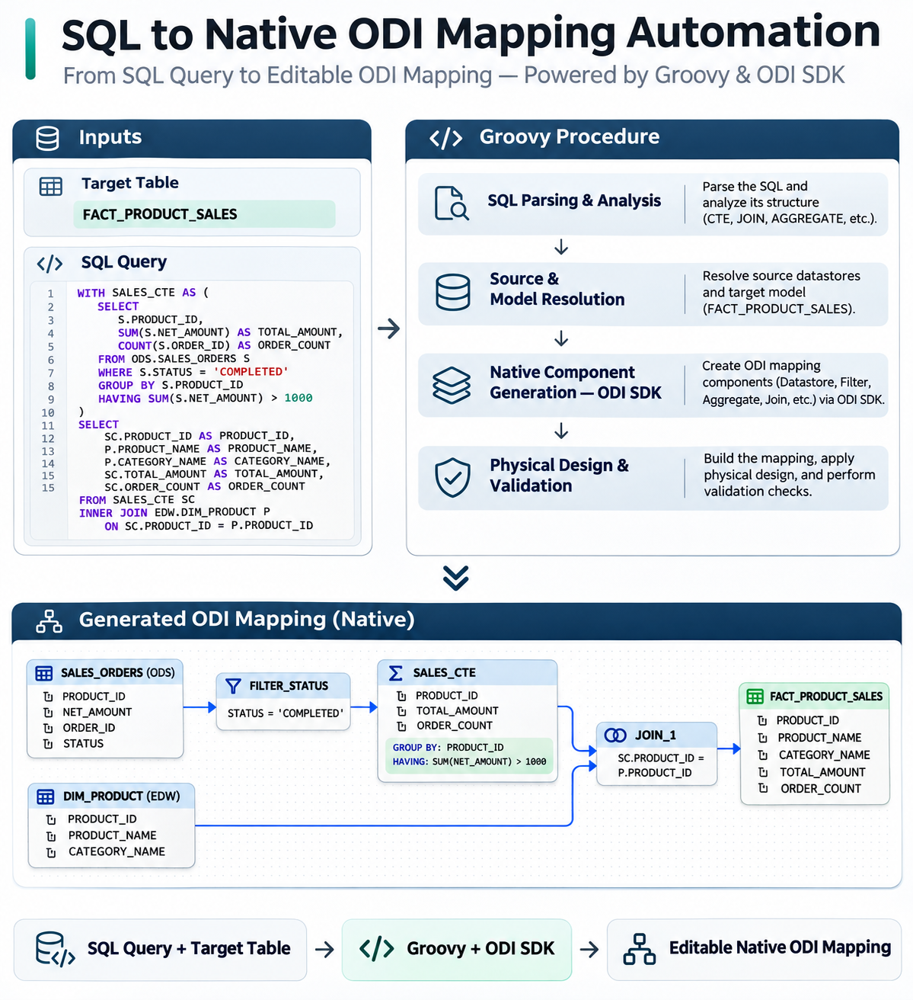

# SQL to Native ODI Mapping Automation

**SQL-driven, native Oracle Data Integrator mapping generation using Groovy and the ODI SDK.**

This repository documents an automation project I developed to reduce the manual work involved in translating SQL queries into Oracle Data Integrator (ODI) mappings.

The solution does **not** place the entire SQL query inside a single execution component. It analyzes the query structure and uses the ODI SDK to assemble native Datastore, Join, Filter, Expression, Aggregate, Distinct, and Set components, followed by target and physical-design configuration.

> **Technical showcase — not a downloadable generator.** The production Groovy implementation, SQL parser, mapping graph-construction logic, request handling code, and environment-specific configuration are not published here. The diagrams and SQL examples use fictional objects and illustrate the approach rather than a portable ODI installation.



*Conceptual illustration based on a fictional SQL query and synthetic datastores; not a screenshot of a live ODI repository.*

## Why I built it

Translating a complex SQL query into a native ODI mapping can involve repetitive configuration of source datastores, joins, filters, transformations, target expressions, and physical integration settings. Even after assembling the mapping, small manual configuration mistakes may require additional debugging.

In my own workflow, some mappings previously took approximately **3–8 hours** to assemble manually. For supported queries, automated mapping **generation** now typically completes in approximately **5–10 seconds** in the environment where I use it. These are observations from my workflow, not a performance guarantee, and do not include data-load execution or independent result verification.

## How it works

```text
  Mapping name + Target datastore + SQL query
                     |
                     v
            SQL structure analysis
                     |
                     v
          ODI repository resolution
          (models / datastores / folders)
                     |
                     v
        Native mapping graph construction
        (components and dependencies)
                     |
                     v
       Target integration + physical design
                     |
                     v
          Validation + persistence
                     |
                     v
             Native ODI Mapping
```

The visual simplifies the input into two main elements (**Target Table** and **SQL Query**). The actual request also needs a **mapping name**.

The implementation works within a configured ODI 12c environment. The target datastore, model selection, folder placement, repository context, and integration Knowledge Module must be resolved against that environment; these are not universal values.

See [Architecture](docs/architecture.md) for a more detailed, implementation-neutral explanation.

## Technical approach

The most challenging part is not invoking a single ODI API. It is interpreting SQL semantics, resolving aliases and dependencies, dealing with reusable CTEs, and building the correct sequence of connected native components.

The solution uses ODI SDK capabilities including:

| Responsibility | ODI SDK class / method used |
| --- | --- |
| Create a mapping | `Mapping` |
| Resolve repository datastores | `IOdiDataStoreFinder.findByName(...)` |
| Represent source and target datastores | `DatastoreComponent` |
| Build join relationships | `JoinComponent.joinSources(...)` |
| Apply filters | `FilterComponent` |
| Project calculated expressions | `ExpressionComponent.addExpression(...)` |
| Create grouped transformations | `AggregateComponent.addAttribute(...)` |
| Apply native HAVING criteria | `AggregateComponent.setHavingText(...)` |
| Model DISTINCT results | `DistinctComponent.addAttribute(...)` |
| Build set operations | `SetComponent.createSet(...)` |
| Connect mapping components | `IMapComponent.connectTo(...)` |
| Configure the physical design | `Mapping.createPhysicalDesign(...)` |
| Assign a Knowledge Module | Physical target node `setIKMByName(...)` |
| Validate mapping designs | `Mapping.validate(...)`, physical design `validate(...)` |
| Persist changes safely | Transaction manager `commit(...)` / `rollback(...)` |

These are **API references**, not a reproduction of the production implementation. See [ODI SDK usage](docs/sdk-usage.md) for how these APIs fit into the approach.

## OOP architecture showcase

A small, **non-production OOP design example** is available under [examples/oop-showcase](examples/oop-showcase/README.md), with the rationale in [OOP design](docs/oop-design.md).

It illustrates a mapping-plan model, dependency validation, a component-adapter interface, and orchestration through separate Groovy classes. Its console adapter only prints synthetic graph descriptors; **it does not parse SQL, connect to ODI, generate native mappings, or perform data loads**. This proposed separation has not been adopted or tested in the production worker presented here. The complete generator remains private.

## SQL structures covered

The implementation includes support for important SQL shapes such as:

- Inner, left outer, and right outer joins, including nested join groups
- `WHERE` filters and derived-table projections
- Expressions and common Oracle SQL functions
- `GROUP BY` and aggregate functions such as `SUM`, `COUNT`, `MIN`, `MAX`, and `AVG`
- `HAVING` through native ODI aggregate-component configuration
- Common Table Expressions (CTEs), including repeated references handled through separate mapping branches
- `SELECT DISTINCT` and `UNION ALL`
- Automatic source-datastore resolution using environment-specific conventions
- Target primary-key inspection to select an INSERT or MERGE integration strategy
- Physical-design creation, Knowledge Module selection, and logical/physical validation

**Support is not universal SQL coverage.** Some constructs remain unsupported or require additional testing. See [SQL coverage and limitations](docs/sql-coverage-and-limitations.md).

## Example

The [example SQL](examples/sample_query.sql) is intentionally fictional and illustrates `WITH`, `WHERE`, `GROUP BY`, `HAVING`, and `INNER JOIN` in one query. Its conceptual mapping flow is:

```text
SALES_ORDERS -> Filter -> Aggregate (CTE with HAVING) --+
                                                        +-> Join -> FACT_PRODUCT_SALES
DIM_PRODUCT --------------------------------------------+
```

All source and target objects in the example are placeholders; the example is **not** ready to execute without creating compatible datastores and adapting an ODI repository.

## Technology

- Oracle Data Integrator 12c
- Groovy executed in the ODI environment
- Oracle Data Integrator SDK
- Oracle Database

## Scope of this repository

Included: project overview, architecture explanation, ODI SDK API inventory, supported-feature boundaries, a synthetic SQL example, a conceptual illustration, and an ODI-independent OOP architecture demonstration.

Not included: the complete SQL parser, CTE dependency/isolation algorithms, repository-specific rules, queue worker, production Groovy generator, or any connection details.

**This is a technical showcase with a standalone illustrative OOP demo, not a downloadable SQL-to-ODI generator or a claim that every SQL query can be automatically converted without validation.**
